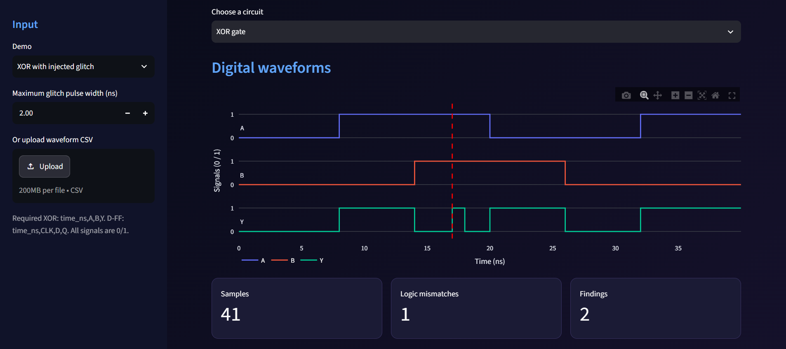
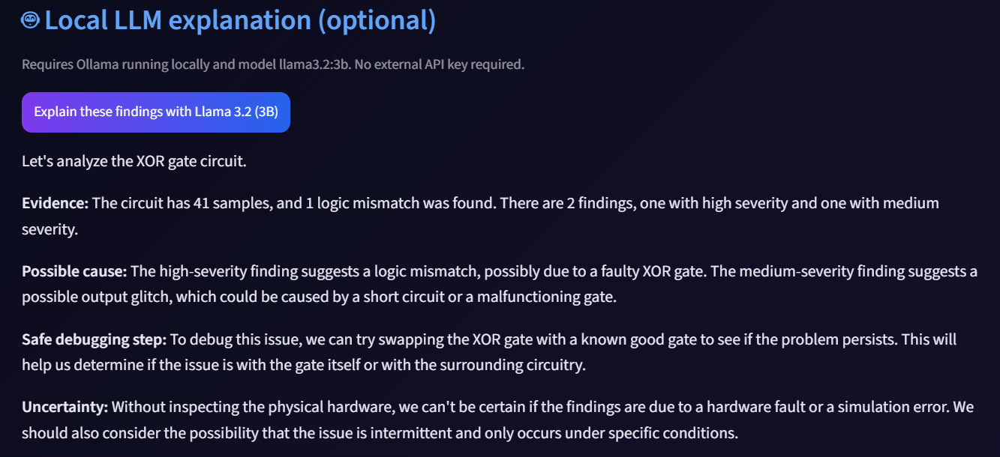

# CircuitMind ⚡ — AI-Assisted Digital Circuit Debugger

An educational Python/Streamlit prototype that analyzes sampled digital waveforms and explains possible problems with a **local LLM (Ollama + Llama 3.2 3B)**.

## What it does

- **XOR gate:** checks whether measured `Y` matches `A XOR B`, and flags one-sample pulses when inputs remain stable.
- **D flip-flop:** finds rising clock edges, checks data transitions against configurable sampled setup and hold windows, and compares observed Q with an idealized model.
- **Interactive waveforms:** visualize time-series digital states using Plotly.
- **Local explanation:** optionally ask `llama3.2:3b` to explain the findings. Deterministic Python checks, not the LLM, produce detection results.
- **CSV import and JSON export**, plus unit tests and synthetic demonstration data.

The prototype is NOT an electrical timing simulator. Sampled data does not reveal what happened between samples, or prove metastability, propagation delays, electrical noise, or a root cause.

## Run on Windows (PowerShell)

Open the folder **containing `app.py` and `requirements.txt`** in VS Code, then run:

```powershell
py -3 -m venv .venv
.\.venv\Scripts\python.exe -m pip install -r requirements.txt
.\.venv\Scripts\python.exe generate_data.py
.\.venv\Scripts\python.exe -m streamlit run app.py
```

Open the Local URL reported by Streamlit (normally `http://localhost:8501`).

### Optional LLM explanation

Install and start Ollama separately, and ensure the model exists:

```powershell
ollama list
ollama pull llama3.2:3b
```

The app contacts only `http://127.0.0.1:11434/api/generate` when you press the AI explanation button. Ollama must be running locally. **The dashboard and deterministic analysis work without Ollama.**

## Run tests

```powershell
.\.venv\Scripts\python.exe -m unittest discover -s tests -v
```

## CSV input format

XOR example:

```csv
time_ns,A,B,Y
0,0,0,0
1,1,0,1
2,1,1,0
```

D-FF example:

```csv
time_ns,CLK,D,Q
0,0,0,0
1,1,0,0
2,1,0,0
```

Times must strictly increase and signal levels must be 0 or 1. Demo traces use 1 ns sampling; detection of narrow pulses depends on the sampling period.

## Project structure

```text
app.py              Streamlit interface, waveforms, optional Ollama explanation
analyzer.py         Deterministic logic and sampled timing checks
generate_data.py    Reproducible synthetic circuit samples
data/               Three synthetic example CSVs
requirements.txt    Dependencies
tests/              Standard-library unit tests
```

## Attribution

Built as an AI-assisted learning starter. Review and customize code, test your own scenarios, and document what you personally implemented before presenting it as an independent project.
## 📸 Screenshots

### ⚡ XOR Gate — Anomaly Detection


### 🚨 Detected Findings


### 🤖 AI-Powered Explanation
